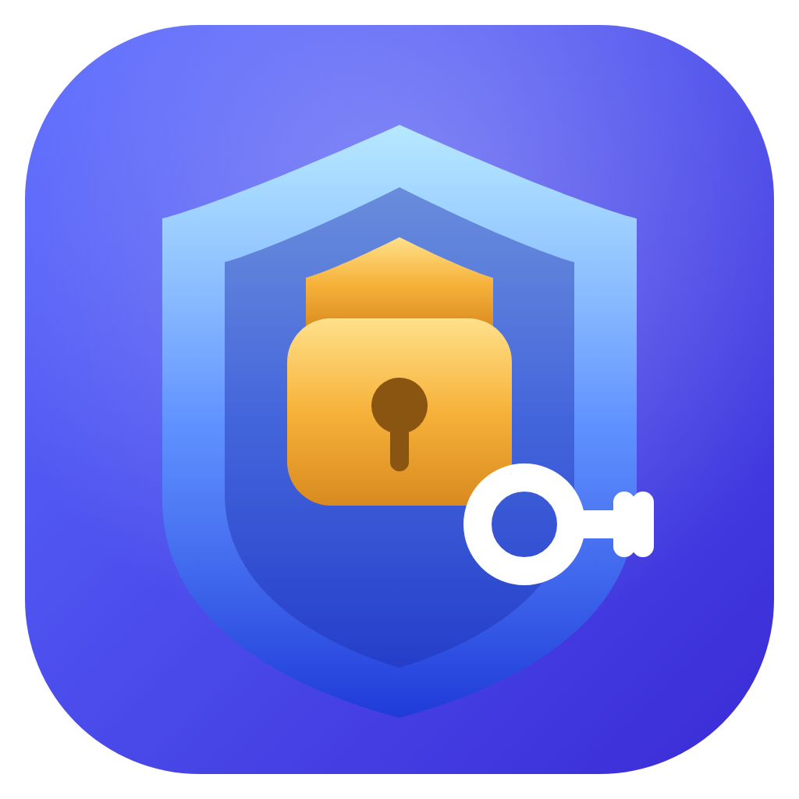
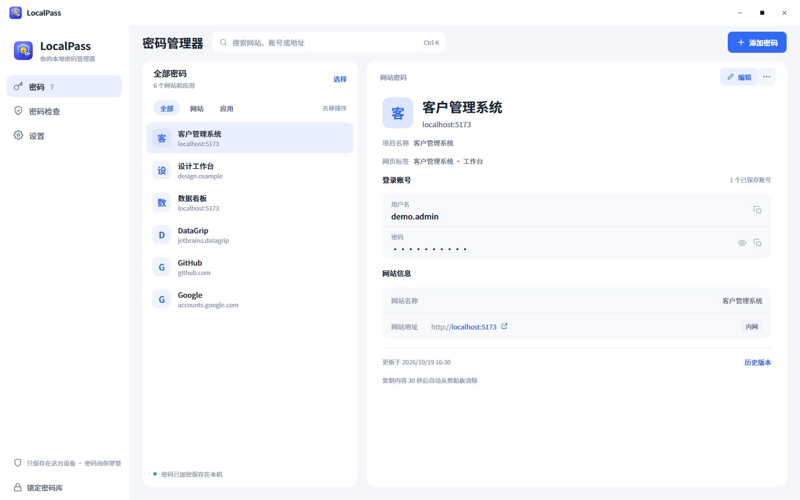
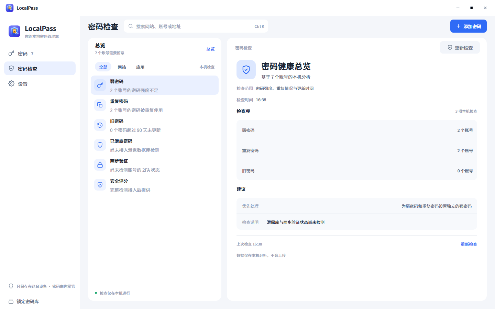
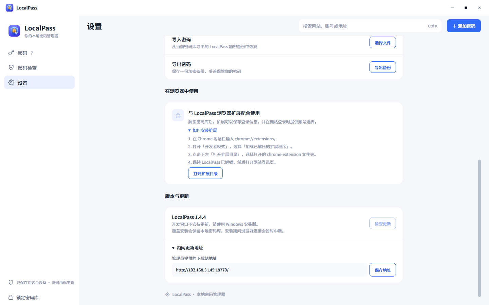

<div align="center">



# LocalPass

**本地优先的密码管理器与浏览器登录助手**

在桌面端管理账号和密码，让浏览器扩展在需要时帮你保存与填写登录信息。

[功能概览](#功能概览) · [界面截图](#界面截图) · [快速开始](#快速开始) · [数据与安全](#数据与安全) · [开发](#开发) · [更新日志](CHANGELOG.md)

</div>

---

## 项目介绍

LocalPass 是一款面向 Windows 桌面端的本地密码管理器。密码库保存在使用者自己的电脑上，桌面应用通过本机连接与 Chrome 扩展配合，捕获登录信息并在网站登录时提供账号选择。

LocalPass 不要求注册云服务账号，也不把密码上传到下载服务器。当前版本没有跨设备在线同步；迁移设备请保留完整的本地密码库目录，详情见[数据与安全](#数据与安全)。

## 功能概览

| 功能               | 说明                                                                           |
| ------------------ | ------------------------------------------------------------------------------ |
| 本地加密密码库     | 使用独立账号和主密码解锁本机 SQLite 密码库，密码字段使用 AES-256-GCM 加密      |
| 浏览器登录助手     | Chrome 扩展可捕获登录表单并提供账号选择；桌面端需运行且密码库已解锁            |
| 多账号与密码历史   | 同一网站或应用可保存多个账号，修改密码后保留历史版本                           |
| 网站与开发项目识别 | 记录网站名称、标签页标题、完整地址和端口；开发环境可按主机、端口与项目名称区分 |
| 密码检查           | 在本机检查重复密码和较弱密码，不连接在线泄露数据库                             |
| 密码生成与复制保护 | 生成随机密码；复制的密码在 30 秒后清除剪贴板（仅当剪贴板内容未被替换）         |
| 桌面使用体验       | 支持浅色、深色和系统主题；可后台运行并通过系统托盘重新打开或退出               |
| 应用内更新         | 从管理员配置的下载站检查更新，下载与安装由使用者确认                           |

## 界面截图

截图使用隔离的示例账号，不含真实密码库数据。

| 密码管理                                                                         | 密码检查                                                                         | 设置与更新                                                                         |
| -------------------------------------------------------------------------------- | -------------------------------------------------------------------------------- | ---------------------------------------------------------------------------------- |
|  |  |  |

更多页面状态见 [41 张界面截图索引](screenshots/logo-preview-1632/index.html)。

## 快速开始

### 安装桌面端

在局域网内打开 [LocalPass 下载页](http://192.168.3.145:18770/)，下载并运行 Windows 安装包，然后创建自己的 LocalPass 账号和主密码。每位使用者都应使用自己的账号和密码库。

### 安装 Chrome / Edge 扩展

1. 从下载页获取并解压 LocalPass 扩展压缩包。
2. Chrome 打开 `chrome://extensions/`，Edge 打开 `edge://extensions/`，开启“开发者模式”。
3. 选择“加载已解压的扩展程序”，指定解压后的 `chrome-extension` 文件夹。
4. 启动 LocalPass 并解锁密码库，然后刷新网站登录页。

扩展通过本机 `127.0.0.1:35320` 与桌面端通信。密码库锁定或桌面端退出时，扩展无法读取、填写或保存密码。

桌面端 1.4.6 起支持扩展独立自动更新：在「设置 → 在浏览器中使用」点击「打开扩展目录」安装扩展；已有用户点击「绑定已有扩展目录」，选择浏览器当前加载的文件夹，然后首次手动重新加载扩展以启用 1.3.6 的自动更新机制。以后桌面端每 15 分钟从配置的内网下载站下载新版文件，扩展在空闲时自动重新加载，无需重新下载 ZIP 或更新桌面软件。浏览器新增权限提示需确认。扩展 1.3.7 起会自动接管已打开的网页，保留已输入内容；点击登录输入框即可使用，桌面端短暂断连也会自动重试。

点击浏览器工具栏中的 LocalPass 图标，可以查看桌面连接、当前网页检测脚本和最近一次登录保存的状态。状态信息仅在浏览器会话中保存，不包含账号、密码或令牌。“服务工作进程（不活动）”表示扩展处于空闲状态，并不代表连接故障。

账号选择框优先显示在输入框上方或侧边。如果浏览器自带密码提示遮挡选择框，在登录输入框按 `Alt+Shift+L` 可进入 LocalPass 账号列表，再用 Tab、Enter 或鼠标选择账号。

桌面端 1.4.7 起，内网站点匹配到多个账号也直接使用网页内的账号列表，不会因输入框获得焦点而弹出桌面选择窗口。仅保存时遇到覆盖或匹配不明确的情况会要求确认；新账号及已有相同密码无需确认。

桌面端 1.4.8 起，Windows 下仅更新或覆盖安装可恢复先前已解锁的密码库：安装前须保持软件运行并解锁，安装完成后 15 分钟内启动。交接使用 Windows 当前用户加密的临时密钥，不保存主密码；正常退出、手动锁定及无有效交接的启动仍需主密码。首次从旧版本升级需手动解锁一次。扩展 1.3.7 可自动接管已打开的 HTTP/HTTPS 网页，避免更新后必须刷新页面。

## 数据与安全

- Windows 安装版的密码库默认位于 `%APPDATA%\localpass\vaults`。其中 `system.db` 保存账号目录，`user_*.db` 保存各账号的密码记录；迁移或备份时必须保留完整目录。
- 数据库中的密码字段使用 AES-256-GCM 加密，密钥由主密码和该密码库随机生成的盐派生。忘记主密码无法解密密码记录。
- 设置中的 `.localpass` 文件是加密导出，但当前格式依赖原密码库的加密密钥，不能单独导入到新建的独立密码库。跨电脑迁移请在完全退出 LocalPass 后复制整个 `vaults` 文件夹，并在新电脑上用原账号和主密码登录。
- 下载站和 WSL 仅用于分发安装包、扩展与更新元数据，不存储或同步密码。
- 登录助手的通信限于本机。密码检查也在本地完成，不会向第三方网站查询密码是否泄露。

## 开发

开发环境需要 Node.js 22 和 npm。

```bash
npm install
npm run dev
```

常用检查与构建：

```bash
npm test
npm run test:extension
npm run test:projects
npm run build
npm run build:win
npm run package:distribution
```

Windows 安装包生成在 `dist/release/`；下载页、安装包和扩展压缩包生成在 `dist/downloads/site/`。部署到 WSL 的步骤见[WSL 发布说明](docs/WSL发布说明.md)。

## 项目结构

| 路径                | 内容                                                |
| ------------------- | --------------------------------------------------- |
| `src/main/`         | Electron 主进程、本地桥接、账号认证与 SQLite 密码库 |
| `src/preload/`      | 渲染进程可调用的隔离 IPC 接口                       |
| `src/renderer/`     | Vue 桌面界面                                        |
| `chrome-extension/` | Chrome Manifest V3 扩展                             |
| `native-messaging/` | 浏览器 Native Messaging 集成                        |
| `database/`         | 数据库初始化与结构文件                              |
| `deploy/wsl/`       | 下载页、Nginx 与 WSL 部署配置                       |

## 相关文档

- [WSL 下载站部署与更新](docs/WSL发布说明.md)
- [开发环境项目匹配](docs/开发环境项目匹配.md)
- [界面设计说明](docs/UI设计说明.md)
